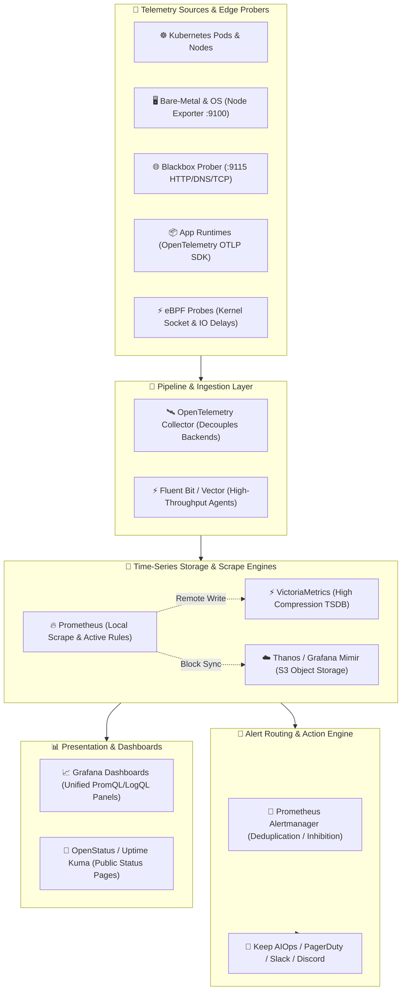

  

  
  
  
  
  
  

---

# 🚀 Awesome Systems Monitoring & Alerting

> **A definitive, SEO-optimized directory of enterprise SaaS platforms and battle-tested open-source projects for infrastructure metrics collection, real-time alert routing, distributed tracing, and high-cardinality time-series storage (TSDB).**

Curated for Site Reliability Engineers (SREs), DevOps architects, platform engineers, and systems administrators designing resilient, high-availability monitoring stacks that eliminate alert fatigue and vendor lock-in.

---

## 📑 Table of Contents

- [📊 Sector Overview & Market Dynamics](#-sector-overview--market-dynamics)
- [🏢 SaaS & Hosted Platforms](#-saas--hosted-platforms)
  - [SaaS Solutions Comparison Matrix](#saas-solutions-comparison-matrix)
  - [Detailed Platform Deep-Dives](#detailed-platform-deep-dives)
- [💻 Open-Source GitHub Projects](#-open-source-github-projects)
- [🏗️ Modern Architecture Blueprint](#️-modern-architecture-blueprint)
- [🤝 How to Contribute](#-how-to-contribute)
- [⭐ Star History](#-star-history)
- [💖 Support & Community](#-support--community)
- [⚖️ Disclaimer & License](#️-disclaimer--license)

---

## 📊 Sector Overview & Market Dynamics

The global **Systems Monitoring, Observability, and AIOps** market was valued at **$22.4 Billion in 2024** and is projected to surge past **$53.8 Billion by 2032**, expanding at a Compound Annual Growth Rate (CAGR) of **~11.8%**. This continuous growth is propelled by cloud-native microservices sprawl, Kubernetes containerization, multicloud deployments, and the explosive telemetry footprint of real-time AI/LLM inference workloads.

The sector is **moderately fragmented**: while a top tier of enterprise giants (Datadog, Cisco/Splunk, Dynatrace, New Relic) commands substantial market share through all-in-one proprietary suites, it is distinctly **not a winner-take-all market**. The ubiquitous industry standardization of **OpenTelemetry (OTel)**, escalating SaaS ingest and egress costs, and stringent data sovereignty regulations have fostered a vibrant countervailing ecosystem of modular, high-efficiency, self-hosted open-source backends (Prometheus, VictoriaMetrics, Mimir, ClickHouse) that prevent single-vendor capture.

---

## 🏢 SaaS & Hosted Platforms

The enterprise SaaS observability tier provides out-of-the-box integrations, automated topology discovery, enterprise SLA support, and zero maintenance overhead. The table below is sorted in **descending order by company valuation/market capitalization**.

### SaaS Solutions Comparison Matrix

| # | 🏢 Platform | 💰 Company Size / Valuation | 🏷️ Starting Pricing | 🎁 Free Tier / Trial Limits | 🎯 Primary Capabilities & Ecosystem Strengths |
|---|---|---|---|---|---|
| 1 | **[Datadog](https://www.datadoghq.com/)** | **~$40 Billion** *(Market Cap, NASDAQ: DDOG; ~$2.68B+ ARR)* | **$15 / host / month** *(Pro tier, billed annually; or $18 on-demand)* | **Free forever up to 5 hosts** (1-day metric retention); plus **14-day free trial** with unlimited hosts & full features | Industry-leading UX, 750+ turn-key integrations, unified infrastructure, APM, synthetic monitoring, and log correlation. Fleet bills scale with host and container count. |
| 2 | **[Splunk Observability Cloud](https://www.splunk.com/)** | **~$28 Billion** *(Acquired by Cisco for $28B in 2024; Cisco Market Cap ~$220B)* | **$15 / host / month** *(Infrastructure Monitoring, billed annually; or $65/host/mo for full APM Suite)* | **14-day free trial** with full access, up to 100 hosts and 5,000 metrics streams; no credit card required | Real-time streaming analytics engine (NoSample full-fidelity tracing), OpenTelemetry-native ingest, enterprise SIEM security correlation, and Splunk core integration. |
| 3 | **[Dynatrace](https://www.dynatrace.com/)** | **~$15 Billion** *(Market Cap, NYSE: DT; ~$1.55B+ ARR)* | **$0.04 / 8 GB host-hour** *(~$29/host/mo for Infra) or **$0.08 / 8 GB host-hour** (~$58/host/mo for Full-Stack)* | **15-day free trial** including 1,000 host-hours monitoring, up to 5 hosts, Davis AI root-cause engine; no credit card required | Automated OneAgent injection, Davis AI deterministic root-cause analysis, Smartscape automated topology mapping, enterprise digital experience monitoring (DEM). |
| 4 | **[Elastic Observability](https://www.elastic.co/observability)** | **~$9 Billion** *(Market Cap, NYSE: ESTC; ~$1.33B+ ARR)* | **$95 / month** *(Elastic Cloud Standard tier, resource-based at ~$0.024/GB-RAM-hour)* | **14-day free trial** on Elastic Cloud with full Elasticsearch/Kibana features; plus **100% free forever self-managed** Elastic Basic license | Native Prometheus remote-write v1 and PromQL support (added in Elasticsearch 9.5), petabyte-scale unified search across logs, APM traces, and metrics. |
| 5 | **[New Relic](https://newrelic.com/)** | **~$6.5 Billion** *(Acquired by Francisco Partners & TPG for $6.5B; ~$1.0B+ ARR)* | **$0.30 / GB** beyond free allowance; **$49 / user / month** for Full Platform Users (Standard tier) | **Free forever up to 100 GB / month** data ingest, 1 full-platform user, unlimited basic users, and access to all 30+ platform apps | Ingest-centric billing model ideal for dense microservice fleets with many hosts. NRQL querying, unified Telemetry Data Platform (TDP), and full APM stack. |
| 6 | **[Grafana Cloud](https://grafana.com/)** | **~$6.0 Billion** *(Valuation, Series D Unicorn; ~$250M+ ARR)* | **$19 / month** base platform fee (Pro tier) + **$0.50 / 1k metrics series**, **$0.50 / GB logs & traces** | **Free forever plan** with 10,000 active metrics series, 50 GB logs, 50 GB traces, 500 VUh synthetics, and 3 users | Fully managed open-source stack (Mimir, Loki, Tempo, Pyroscope, Grafana). Native PromQL/LogQL queries, zero vendor lock-in, and seamless self-host migration. |
| 7 | **[SolarWinds Observability](https://www.solarwinds.com/)** | **~$2.5 Billion** *(Market Cap, NYSE: SWI; ~$780M+ ARR)* | **$5 / node / month** (Network) or **$15 / host / month** (Infrastructure SaaS, billed annually) | **30-day free trial** with full feature access, unlimited monitored devices/nodes; no credit card required | Deep hybrid IT and on-premises infrastructure monitoring, SNMP/NetFlow network performance analysis, database performance tuning, and IT service desk integration. |
| 8 | **[LogicMonitor](https://www.logicmonitor.com/)** | **~$2.4 Billion** *(Valuation, Vista Equity Partners & PSG backed; ~$300M+ ARR)* | **$22 / device / month** *(Pro tier, annual commitment with 50-device standard fleet minimum)* | **14-day free trial** supporting up to 100 devices with automated LM Envision collectors and dynamic alerting; no credit card required | Agentless collector architecture, automated discovery for 2,000+ technologies, hybrid multicloud visibility, AIOps anomaly detection, and MSP multi-tenancy. |
| 9 | **[Sumo Logic](https://www.sumologic.com/)** | **~$1.7 Billion** *(Acquired by Francisco Partners for $1.7B; ~$300M+ ARR)* | **$2.75 / GB** for log analytics & infrastructure metrics (Essentials tier, billed annually) or **$3.00 / GB** on-demand | **Free forever plan** with 1 GB / day data ingest, up to 3 users, 4 concurrent searches, and 7-day log retention | Cloud-native log analytics and infrastructure monitoring tightly coupled with Cloud SIEM, automated security threat intelligence, and compliance auditing. |

---

### Detailed Platform Deep-Dives

- 🔍 **[Datadog](https://www.datadoghq.com/)**  
  Unified monitoring and analytics platform spanning infrastructure, APM, distributed tracing, log management, and network performance. Pricing is structured on a **per-host basis with annual commitments**; while the UX, dashboards, and turnkey integrations lead the SaaS industry, total costs scale steeply with host count and log ingestion.
- 🔍 **[Splunk Observability Cloud](https://www.splunk.com/)**  
  High-throughput metrics, distributed tracing (via SignalFx acquisition), and log aggregation. Features real-time streaming architecture capable of analyzing 100% of transaction traces without head-sampling, alongside native OpenTelemetry instrumentation.
- 🔍 **[Dynatrace](https://www.dynatrace.com/)**  
  AI-orchestrated observability engine powered by the deterministic Davis AI root-cause engine. Automates instrumentation via its single OneAgent per host and generates dynamic topological dependency graphs (Smartscape) to trace anomalies directly to degraded infrastructure nodes.
- 🔍 **[Elastic Observability](https://www.elastic.co/observability)**  
  Built on the open Elasticsearch and Kibana foundation. **Elasticsearch 9.5** introduced native **Prometheus remote write v1 and native PromQL syntax execution**, allowing SRE teams with existing Grafana/Prometheus investments to back-end directly to Elasticsearch with ~80% query compatibility.
- 🔍 **[New Relic](https://newrelic.com/)**  
  Full-stack observability built upon the Telemetry Data Platform with **consumption-based ingestion pricing ($0.30/GB)** rather than per-host licenses. High-density server environments (e.g., thousands of lightweight Kubernetes nodes) benefit significantly from this pricing model over per-host competitors.
- 🔍 **[Grafana Cloud](https://grafana.com/)**  
  Managed SaaS implementation of the LGTM stack (Loki, Grafana, Tempo, Mimir). Employs **Grafana Mimir** for long-term Prometheus TSDB storage, guaranteeing full compatibility with open-source PromQL queries, Alertmanager rules, and Grafana dashboard templates.
- 🔍 **[SolarWinds](https://www.solarwinds.com/)**  
  Comprehensive monitoring suite specializing in hybrid enterprise IT, bare-metal server fleets, switches/routers, and on-premises data centers, coupled with cloud-native SaaS observability modules.
- 🔍 **[LogicMonitor](https://www.logicmonitor.com/)**  
  Automated SaaS infrastructure monitoring using lightweight on-premises or cloud collectors. Automatically discovers devices across networks, assigns metric thresholds, and provides AI-driven alert suppression.
- 🔍 **[Sumo Logic](https://www.sumologic.com/)**  
  Log analytics, metrics, and security observability platform providing automated pattern recognition (LogReduce) and deep correlation between operational telemetry and SOC security events.

---

## 💻 Open-Source GitHub Projects

Curated open-source projects for self-hosting, data sovereignty, privacy compliance, and eliminating per-host commercial license fees. **Sorted in descending order of GitHub star count.**

1. 🌟 **[Uptime Kuma](https://github.com/louislam/uptime-kuma)**   
   **Self-hosted, responsive monitoring tool and status page platform.** Monitored protocols include HTTP(s), TCP, DNS, Ping, Docker containers, and Steam Game Servers. Supports 90+ notification services (Telegram, Discord, Slack, Webhooks) with multi-language UI, 2FA, and certificate expiry monitoring.

2. 🌟 **[Netdata](https://github.com/netdata/netdata)**   
   **Real-time, per-second systems health and performance monitoring.** Low footprint agent written in C, collecting thousands of metrics per server with sub-1% CPU usage. Zero-configuration auto-detection, pre-configured alert templates, and real-time visualization.

3. 🌟 **[Grafana](https://github.com/grafana/grafana)**   
   **The universal visualization, dashboarding, and alerting layer.** Integrates with Prometheus, Thanos, Mimir, VictoriaMetrics, InfluxDB, Elasticsearch, and 100+ telemetry backends. Provides rich panel templating, unified alert management, and multi-tenant organizational isolation.

4. 🌟 **[Prometheus](https://github.com/prometheus/prometheus)**   
   **The CNCF graduated industry standard for cloud-native metrics collection and alert evaluation.** Employs a pull-based HTTP scraping model, dimensional time-series data model, PromQL query language, and service discovery across Kubernetes, Consul, and EC2.

5. 🌟 **[Glances](https://github.com/nicolargo/glances)**   
   **Cross-platform, Python-based terminal and web system monitoring tool.** Provides curses-based CLI, responsive web UI, and REST API. Monitors CPU, memory, load, network, disk I/O, processes, and container runtimes (Docker, Podman) with zero external database dependencies.

6. 🌟 **[SigNoz](https://github.com/SigNoz/signoz)**   
   **Full-stack, OpenTelemetry-native observability platform.** Combines metrics, distributed traces, and log aggregation into a unified application. Built upon high-throughput ClickHouse storage, providing an open-source alternative to Datadog and New Relic.

7. 🌟 **[InfluxDB](https://github.com/influxdata/influxdb)**   
   **High-performance time-series database engine.** Optimized for real-time querying, high write throughput, and downsampling of IoT and system metrics. InfluxDB 3.0 core is written in Rust and powered by Apache Arrow, DataFusion, and Parquet on object storage.

8. 🌟 **[Jaeger](https://github.com/jaegertracing/jaeger)**   
   **CNCF graduated distributed tracing system.** Originally open-sourced by Uber. Monitors complex microservice transactions, diagnoses latency bottlenecks, evaluates root causes, and maps service dependency graphs with native OpenTelemetry OTLP trace support.

9. 🌟 **[Vector](https://github.com/vectordotdev/vector)**   
   **Ultra-fast, memory-safe observability data pipeline written in Rust.** Ingests, transforms, and routes logs, metrics, and traces at multi-gigabyte throughput. Features Vector Remap Language (VRL) for low-overhead schema mutation and filter rules.

10. 🌟 **[VictoriaMetrics](https://github.com/VictoriaMetrics/VictoriaMetrics)**   
    **High-performance, cost-efficient time-series database and Prometheus long-term storage.** Single static executable with zero external dependencies. Consumes up to **10x less RAM than InfluxDB** and provides up to **7x better on-disk compression**. MetricsQL provides a powerful PromQL superset.

11. 🌟 **[Telegraf](https://github.com/influxdata/telegraf)**   
    **Plugin-driven server agent for collecting and reporting metrics.** Over 300+ community input plugins for databases, messaging systems, hardware sensors, and cloud services, with direct outputs to InfluxDB, Prometheus remote-write, Kafka, and OpenTelemetry.

12. 🌟 **[Thanos](https://github.com/thanos-io/thanos)**   
    **Seamless, non-disruptive long-term metric storage for Prometheus fleets.** Employs a sidecar model attached to running Prometheus instances. Streams historical TSDB blocks directly into S3/GCS/Azure object storage, deduplicates HA instances, and provides a global PromQL query federation.

13. 🌟 **[OpenSearch](https://github.com/opensearch-project/OpenSearch)**   
    **Community-driven, Apache 2.0 open-source search and analytics suite.** Forked from Elasticsearch 7.10, providing large-scale log analytics, anomaly detection, trace analytics, and operational dashboarding without commercial SSPL license restrictions.

14. 🌟 **[Node Exporter](https://github.com/prometheus/node_exporter)**   
    **The standard Prometheus exporter for hardware and OS metrics.** Exposes CPU core utilization, disk I/O latency, memory fragmentation, network interface queues, filesystem capacity, and systemd service states on port 9100.

15. 🌟 **[Keep](https://github.com/keephq/keep)**   
    **Open-source AIOps, alert management, and incident orchestration platform.** Deduplicates, enriches, and correlates alerts across Datadog, Prometheus, Grafana, CloudWatch, and PagerDuty into a centralized workflow automation engine with natural language rule definitions.

16. 🌟 **[OpenStatus](https://github.com/openstatusHQ/openstatus)**   
    **Open-source synthetic monitoring and status page platform.** Delivers edge-based latency tracking, status incident reporting, Monitoring-as-Code via declarative YAML, and automated incident subscriber alerts via email, Discord, and Slack.

17. 🌟 **[Alertmanager](https://github.com/prometheus/alertmanager)**   
    **The standard routing and deduplication engine for the Prometheus ecosystem.** Aggregates firing alert instances, suppresses cascaded alerts via inhibition rules, manages maintenance silences, and routes notifications to Slack, Opsgenie, PagerDuty, email, and webhooks.

18. 🌟 **[Fluent Bit](https://github.com/fluent/fluent-bit)**   
    **Fast, lightweight telemetry agent and processor written in C.** Consumes under 10 MB RAM, processing logs, metrics, and traces from container runtimes (Kubernetes CRI, Docker) and forwarding to Prometheus, OpenSearch, Kafka, and OpenTelemetry backends.

19. 🌟 **[Coroot](https://github.com/coroot/coroot)**   
    **Zero-code APM and observability engine powered by eBPF.** Inspects Linux kernel network sockets, CPU task delays, memory leaks, and Postgres/MySQL database query latency without code changes or proprietary agent SDKs.

20. 🌟 **[OpenTelemetry Collector](https://github.com/open-telemetry/opentelemetry-collector)**   
    **Vendor-agnostic telemetry ingestion, processing, and export proxy.** Acts as a universal gateway supporting OTLP, Prometheus, Zipkin, and Jaeger protocols. Allows SREs to change backends without re-instrumenting application codebases.

21. 🌟 **[Zabbix](https://github.com/zabbix/zabbix)**   
    **Enterprise-grade distributed monitoring platform.** Highly capable across hybrid topologies with native agent, agentless SNMP/IPMI monitoring, proxy collectors, SLA tracking, and scheduled maintenance windows.

22. 🌟 **[Blackbox Exporter](https://github.com/prometheus/blackbox_exporter)**   
    **Endpoint probing tool for Prometheus.** Probes HTTP, HTTPS, DNS, TCP, and ICMP endpoints on port 9115 to verify SSL certificate expiration, response codes, TLS handshake durations, and round-trip network ping latencies.

23. 🌟 **[Cortex](https://github.com/cortexproject/cortex)**   
    **Horizontally scalable, multi-tenant Prometheus storage system.** CNCF graduated project. While stable and functional, modern greenfield production deployments typically favor **Grafana Mimir**, which was built by the original core maintainers as Cortex's operational successor.

24. 🌟 **[Grafana Mimir](https://github.com/grafana/mimir)**   
    **High-scale, multi-tenant long-term time-series storage for Prometheus.** Engineered for 100M+ active series per tenant. Employs split-microservice architecture (Ingester, Distributor, Store-Gateway, Compactor) writing immutable chunks to object storage (S3/GCS).

25. 🌟 **[Icinga 2](https://github.com/Icinga/icinga2)**   
    **Scalable multi-threaded monitoring engine and Nagios successor.** Features an expressive domain-specific configuration language (DSL), REST API, distributed satellite cluster topologies, and robust performance check execution.

26. 🌟 **[Nagios Core](https://github.com/NagiosEnterprises/nagioscore)**   
    **The foundational open-source host, service, and network monitoring standard.** Proven architecture running scheduled active check scripts, plugin hooks, escalation trees, and basic notification alerts.

27. 🌟 **[Upright](https://github.com/basecamp/upright)**   
    **37signals' multi-region synthetic monitoring system.** Executes real Playwright browser automation scripts with video recording upon test failure. Employs a 5-node global consensus design that distinguishes isolated network blips from genuine global service outages for ~$110/month.

28. 🌟 **[Statuz](https://github.com/statuzlabs/statuz)**   
    **Minimalist self-hosted status page and uptime check daemon.** Single Go binary pairing HTTP/TCP health checks with incident report tracking, automated uptime calculations, and SQLite/PostgreSQL storage.

---

## 🏗️ Modern Architecture Blueprint

---

## 🤝 How to Contribute

We welcome community contributions, benchmark updates, and new tool additions!

1. 🍴 **Fork the repository** on GitHub.
2. 🌿 **Create a descriptive feature branch**: `git checkout -b feature/add-new-monitoring-tool`.
3. 📝 **Add or update the tool entry** in `README.md`:
   - Follow the established format (name, link, verified GitHub star badge, and architectural summary).
   - For SaaS tools: include company size/valuation, starting tier pricing, and free tier limits.
   - For open-source tools: verify star badge syntax `` and ensure descending sort order.
4. 🧪 **Check markdown rendering** and verify all links.
5. 🚀 **Submit a Pull Request** with a concise description of your changes.

---

## ⭐ Star History

---

## 💖 Support & Community

Thank you for visiting and supporting **Awesome Systems Monitoring & Alerting**! Maintaining an accurate, up-to-date observability directory requires continuous tracking of product acquisitions, open-source releases, pricing revisions, and architecture patterns.

If this repository assisted your infrastructure evaluations, helped debug an on-call architecture, or saved your team time, please show your support:

- ⭐ **Star this repository** on GitHub to amplify its reach across the DevOps community.
- 🍴 **Fork and contribute** by suggesting new tools, exporter patterns, or documentation refinements.
- 📢 **Share with your colleagues** on LinkedIn, X/Twitter, Reddit (`r/devops`, `r/sre`, `r/sysadmin`), and team channels.
- ☕ **Sponsor ongoing maintenance** or buy a coffee via the [GitHub Sponsor Dashboard](https://github.com/sponsors/ishandutta2007).

  

---

## ⚖️ Disclaimer & License

- **Curated Community Directory**: This list is independently maintained for educational and architectural evaluation purposes. Mention of commercial products or open-source projects does not constitute a formal endorsement.
- **Operational Reality**: Systems monitoring tools differ significantly in operational overhead, scale ceilings, and storage philosophies. Always empirically benchmark TSDB storage consumption, retention compression, and alert thresholds against your team's baseline workloads to prevent alert fatigue.
- **License**: Distributed under the [MIT License](LICENSE).
